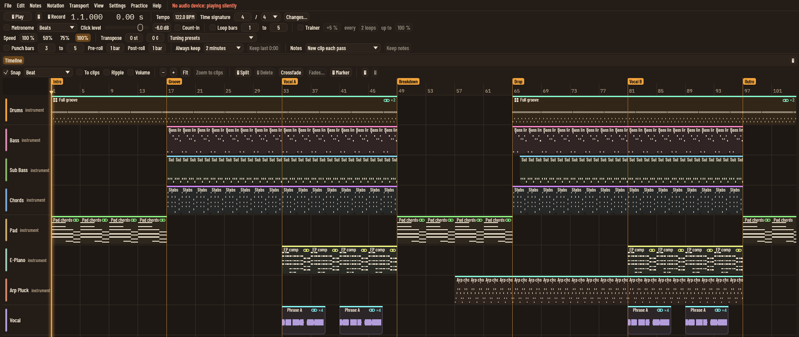
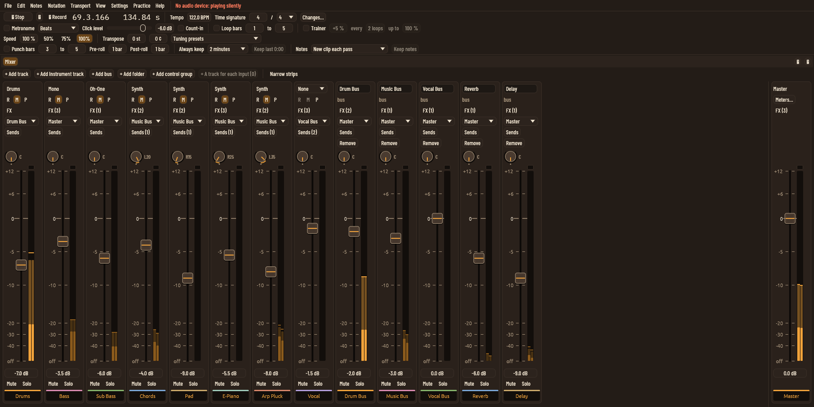
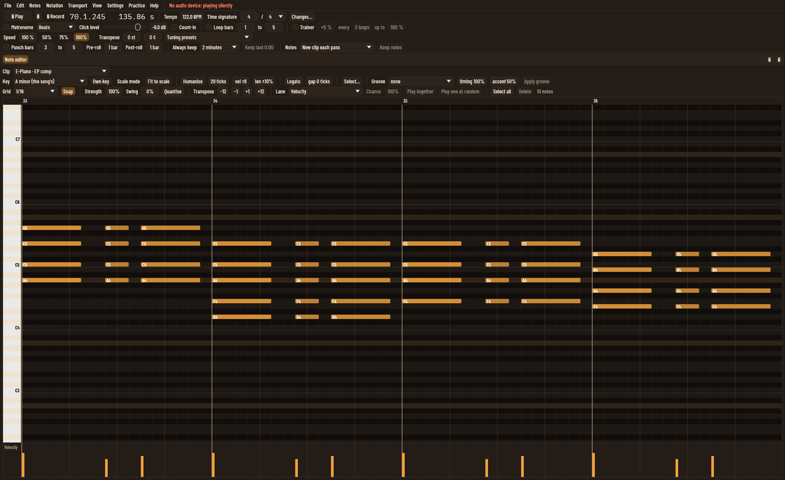
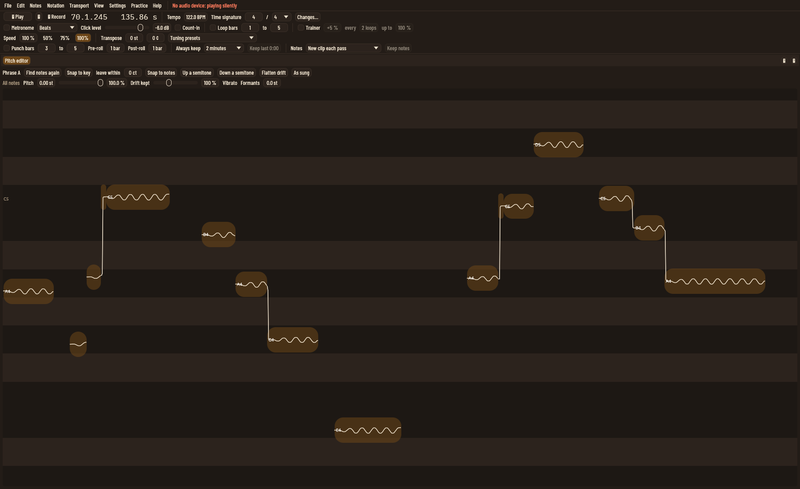
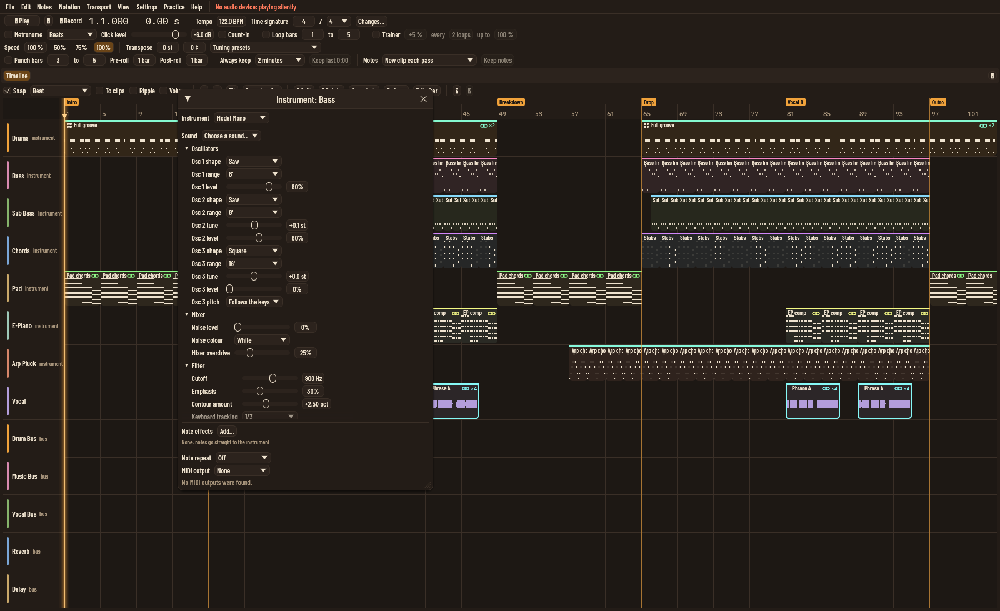

# DAW (working title)

A **native desktop digital audio workstation** for Windows, macOS and Linux.

It starts as a tool for **guitar lessons**: teacher and student share a
project, record takes through their amp-sim plugins with low latency,
practise against backing tracks at reduced speed, and leave feedback pinned
to the music. From there it grows into a full **professional DAW** with
first-class **VST 3** support and a **Live Looper** performance mode in
which every loop and layer is visible on the timeline.

There is **no backend server**. Projects are folders on your disk, and
collaboration is peer-to-peer (the teacher hosts a session) or via project
bundles and shared folders.

> **Status:** Phase 0. Proceeding with Rust at risk while the on-device
> spike tests wait for the test machine (see
> [decision 0003](docs/decisions/0003-implementation-language.md)). Steps
> waiting for the owner are listed in the
> [review queue](docs/review-queue/README.md).

## Screenshots

A snapshot of the app as it stands, with a deep house test song built
through the assistant interface (122 bpm, A minor; the vocal is a
synthesised stand-in). These will change as the app does.

**Arrangement:** song sections and linked clip copies.



**Mixer:** desk-style strips with vertical faders, meters, routing and
sends, playing the drop.



**Note editor:** the electric piano part, with the key, quantise, groove
and velocity lane.



**Pitch editor:** a vocal phrase split into notes, with its vibrato
and drift.



**Synth:** the three-oscillator mono synth playing the bass line.



## Running it on Windows

**Ready-made build:** every push to `main` builds `daw.exe` in CI. Open
the latest green **ci** run on `main` under the repository's Actions tab
and download the **daw-windows-x64** artifact (a zip holding `daw.exe`).

**From source** (what the Windows CI job does):

1. Install the Visual Studio Build Tools with the **Desktop development
   with C++** workload (the MSVC linker Rust needs).
2. Install Rust with [rustup](https://rustup.rs), stable toolchain
   (1.88 or newer).
3. Install LLVM and point `LIBCLANG_PATH` at it, for example
   `C:\Program Files\LLVM\bin`. The ASIO bindings are generated with
   bindgen, which needs libclang.
4. From the repository folder, run:

   ```
   cargo run --release -p daw-app
   ```

   Use a release build for anything with audio. The first build
   downloads Steinberg's ASIO SDK, so it needs internet access.

For the lowest delay, install your audio interface maker's ASIO driver.
The first time the app starts with no audio settings saved, the guided
audio setup opens and offers the ASIO device first.

## Documents

| Document | Purpose |
|---|---|
| [docs/ROADMAP.md](docs/ROADMAP.md) | Phased plan: Rust spike, Lesson Room vertical slice, then a full DAW |
| [docs/ARCHITECTURE.md](docs/ARCHITECTURE.md) | Proposed architecture: engine, plugin hosting, project format, P2P collaboration |
| [docs/CLEAN_ROOM.md](docs/CLEAN_ROOM.md) | Rules for keeping the project original and legally defensible |
| [docs/GLOSSARY.md](docs/GLOSSARY.md) | Project vocabulary (generic and original terms only) |
| [docs/research/CAPABILITY_LANDSCAPE.md](docs/research/CAPABILITY_LANDSCAPE.md) | Generic survey of DAW and loop-station capabilities, mapped to phases, plus research gaps |
| [docs/decisions/](docs/decisions/) | Decision records |
| [CONTRIBUTING.md](CONTRIBUTING.md) | How to contribute: clean-room rules, sign-off, checks to run |
| [spikes/](spikes/) | Phase 0 throwaway prototypes and their results |

## Principles

- **Native, low-latency audio:** ASIO, CoreAudio, WASAPI, ALSA, JACK, PipeWire.
- **Plugins first-class:** VST 3 from the first release; CLAP, AU and ARA after.
- **Local-first and serverless:** your data stays on your machines.
- **Original work:** clean-room policy; no copying or reverse engineering.
- **Audio correctness:** sample-accurate timing, no dropouts, automated audio tests.

## Licence

GNU General Public License v3.0 or later (`GPL-3.0-or-later`). See
[LICENSE](LICENSE) and [decision 0001](docs/decisions/0001-project-licence.md).
