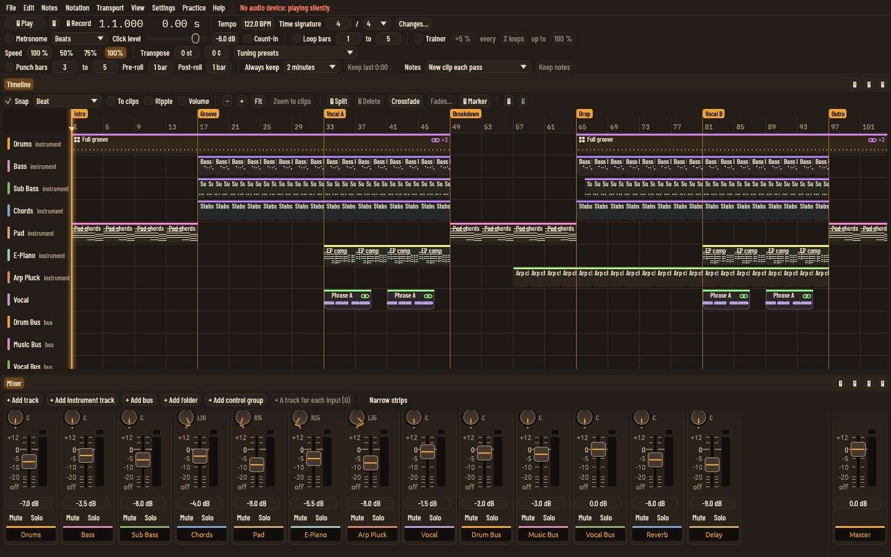
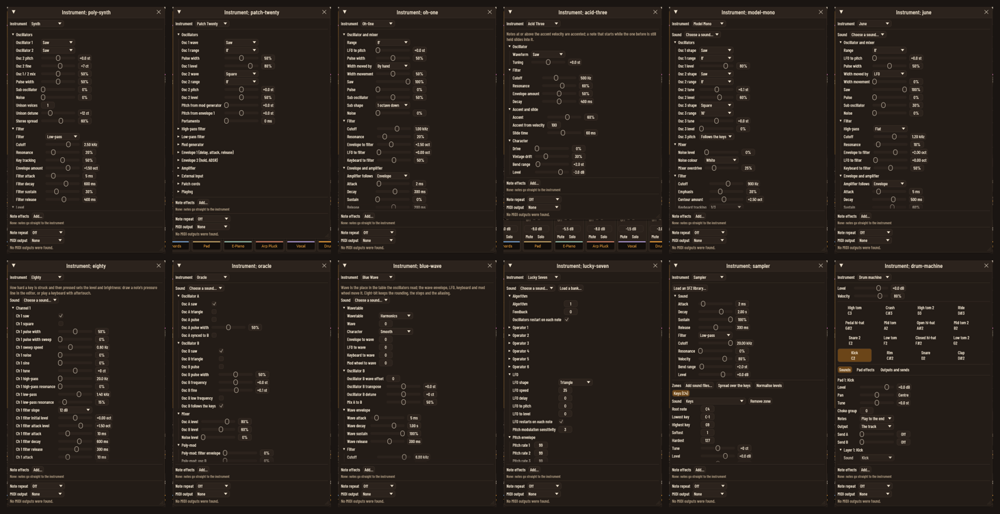
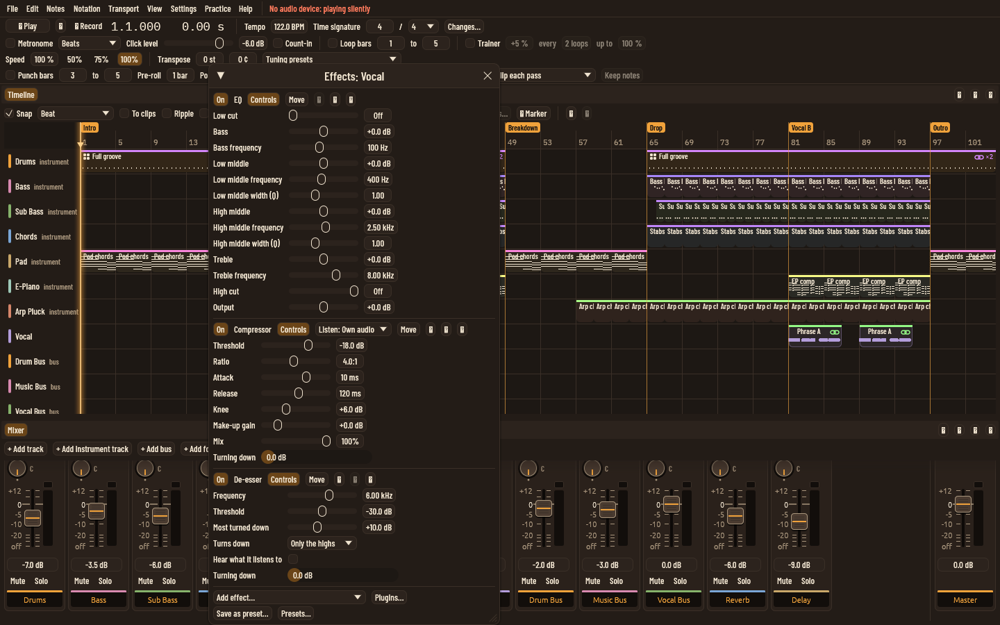
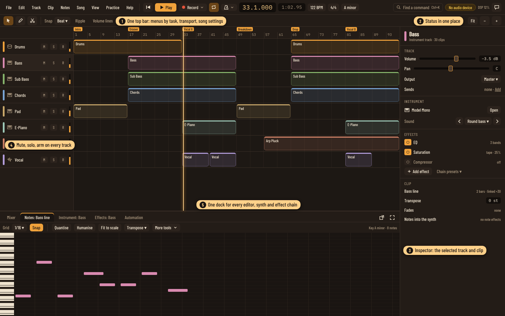
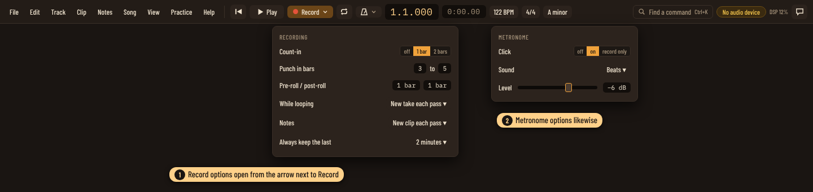
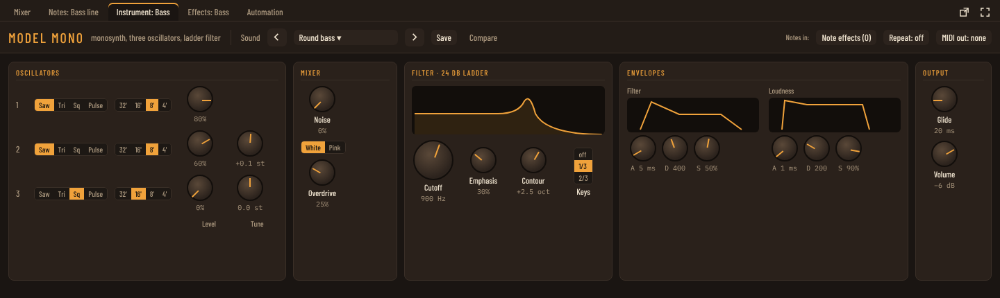
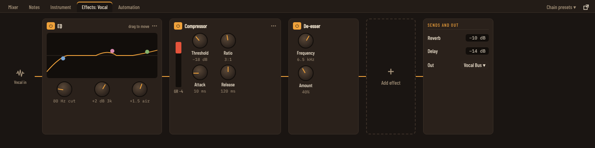
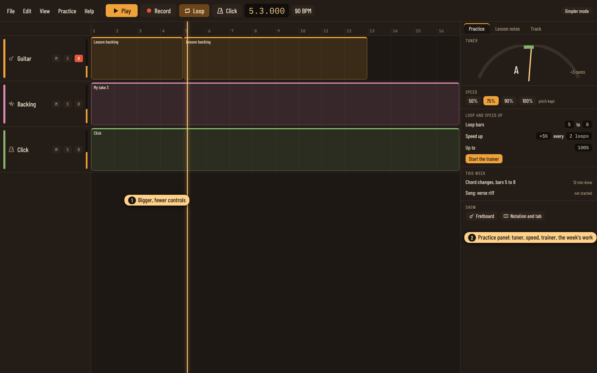

# UI polish pass: one clear layout for the whole app (2026-11-02)

The owner's words: "the UI is a somewhat unwieldy thing at the moment...
everything from the whole screen, through to individual things such as
fx and synths and other panels needs more thought. At the moment it's all
just been dumped there." This plan is the polish pass that comes before
any more feature work. It proposes one structure for the main window, a
home for every panel, and a shared look for instruments and effects, then
splits the work into threads.

Nothing here removes a feature. Every control moves somewhere sensible,
keeps its command, and stays reachable through the AI assistant
interface.

Who it is for: the owner and their guitar teacher, recording, practising
and making songs; and the simpler mode for beginners. The baseline
screen is the owner's laptop, 1920 × 1200. Every thread also checks that
its area still works at 1440 × 900, and a bigger screen gets more room,
not more clutter.

## What is wrong today

Measured on main at 2281d10, with renders in `docs/plans/ui-polish/`.

1. **The transport is four rows of about forty controls**, always on
   screen: play and record sit beside punch bars, pre-roll and post-roll,
   the take-keeping rule, the notes-keeping rule, the speed trainer,
   speed presets, transpose in semitones and cents, and tuning presets.
   Most are used once a session or never. Simpler mode hides menus but
   leaves all four rows.
2. **Icons show as empty boxes.** The app draws its icons as Unicode
   symbols (play, stop, record, back to start, scissors, bin, flag, the
   pane buttons). Since the move to egui 0.37 the emoji fallback fonts
   that held those symbols sit behind the `monochrome_emoji_fonts`
   feature, which is off, so every one of them is a box (checked against
   the font files: our faces have none of them, and egui's default set
   no longer includes them). Some symbols (up and down triangles, the
   undo arrows, the microphone) were never in any bundled font.
3. **The menus are lists of every command.** There are about 270
   commands; the Edit menu holds 99 of them in twelve groups (clips,
   sections, play order, hit points, stretch markers, track versions,
   chains, groups...). Settings is ten separate windows. Practice repeats
   items from View.
4. **About 55 floating windows.** Instruments, effect chains, and dialogs
   all float over the timeline wherever they open, at their own sizes,
   covering the work. A track's instrument and its effects can't be seen
   together. Only some things are panes.
5. **Every synth and effect looks the same: a tall list of sliders.**
   The nine classic synths are a single column of labelled sliders under
   fold-out headings, so the Model Mono and the Lucky Seven look alike
   and neither looks like an instrument. Values read as `1.000` or `80%`
   with no curve or meter to show what they do. Note effects, note repeat
   and MIDI output sit at the bottom of the synth's window.
6. **Track headers only show a name.** Mute, solo and arm live in the
   mixer, so recording or muting needs the mixer open.
7. **Editors carry their own toolbars of thirty buttons.** The note editor
   has three rows of tools (quantise, humanise, legato, groove, chance,
   transpose, select, delete...).
8. **The status line shares the menu bar** (device, rate, DSP load,
   progress, "No audio device: playing silently" in red).

Before pictures, rendered at 1440 × 900 in `docs/plans/ui-polish/before/`:

## The proposal

### 1. The main window: four regions

- **Top bar, one row.** Menus; then the transport (back to start, play,
  record with an options arrow, loop, metronome with an options arrow);
  the position in bars and in time; then the song's tempo, time signature
  and key as buttons that open their editors. On the right: Find a
  command (the existing command search, given a visible home and
  Ctrl+K), one status pill (device problems, DSP load, background work),
  and the assistant.
- **Edit toolbar, one slim row** for the timeline: pointer, draw and split
  tools, snap, ripple, volume lines, fit and zoom. Drawn icons, each with
  a tooltip.
- **Timeline with real track headers**: colour, kind icon, name, mute,
  solo, arm, and a small level meter. Right-click for the rest.
- **Inspector on the right** (collapsible, like the browser on the left),
  as the first tab of the right-hand panel:
  the selected track and clip. Track: volume, pan, output, sends.
  Instrument: its name, the sound with previous and next, and Open.
  Effects: the chain as a list with on/off, Add effect, chain presets.
  Clip: name, length, linked copies, transpose, fades, note effects.
  This replaces most of the small floating windows.
- **One dock at the bottom** with tabs: Mixer, Notes, Pitch, Automation,
  Patterns, Instrument, Effects, Video. Double-clicking a clip opens its
  editor tab; Open in the inspector opens the instrument tab. Each tab
  can still go full size or into its own window, as panes can now.
  The right-hand panel has tabs: Track (the inspector), Practice, Lesson
  notes and Comments. The browser stays on the left. The fretboard and
  notation open as dock tabs.

The existing pane system (`workspace.rs`) already does splits, tabs and
saved layouts; the dock and side panels become fixed regions of it rather
than a free tree, and the nine layout slots keep working.

### 2. The transport: one row and two option panels

| Today (always on screen) | After |
|---|---|
| Play, back to start, record, position, time | Top bar |
| Tempo, time signature, Changes... | Top bar buttons; tempo changes in the tempo window |
| Key (only in the note editor) | Top bar button |
| Metronome, sound, click level, count-in | Metronome options |
| Loop bars from/to | Loop button; the range is drawn and dragged on the ruler |
| Punch bars, pre-roll, post-roll, take keeping, notes keeping | Record options |
| Speed, 50/75/100%, speed trainer | Practice panel |
| Transpose semitones and cents, tuning presets | Practice panel (playback pitch), with tuning presets |

### 3. Icons we draw ourselves

A small icon set (about 40) drawn as vector paths in our own code, using
theme colours, so they render the same on every computer, scale with the
interface size, and suit each theme. Every icon-only button keeps a
tooltip and an accessible name. As a stopgap the first thread turns on
egui's `monochrome_emoji_fonts` feature so nothing is a box while the set
is drawn.

### 4. Menus by task, and one Settings window

| Menu | Holds |
|---|---|
| File | New, open, save, templates, snapshots, bundles, import, export (one Export window with formats, sections, stems, video) |
| Edit | Undo, redo, history, cut, copy, paste, delete, select, suggest edits |
| Track | Add track/instrument/bus/folder/group, versions, freeze, render in place, presets, layers |
| Clip | Split, fades, crossfade, linked copies, tempo and stretch, transpose, pitch, fix timing, bounce |
| Notes | Quantise, humanise, scale, groove, note effects, MIDI learn, notation and tab |
| Song | Sections and play order, markers, insert or delete bars, tempo and signature, hit points and timecode |
| View | Panels and dock tabs, layouts, zoom, simpler mode, theme |
| Practice | Tuner, speed, trainer, lessons, lesson notes, comments, fretboard |
| Help | Find a command, key commands, updates, crash reports, sound credits |

Settings becomes one window with a list of sections down the side:
audio device and guided setup, latency, MIDI, plugins, drum kits, key
commands, theme, assistants, phone remote, performance. Right-click menus
on clips, tracks, the ruler and notes carry the commands for that thing,
so the menus are rarely needed.

### 5. Instruments and effects get front panels

One panel kit, used by every built-in instrument and effect:

- **Modules** laid out left to right in signal order (oscillators, mixer,
  filter, envelopes, modulation, output), each a framed block with a
  heading.
- **Widgets**: rotary knobs (the mixer desk's pan pot grown up), switches
  for small choices instead of drop-downs, a large knob for the one
  control that matters most (the filter cutoff), and small displays drawn
  live: the filter's response, envelope shapes, an EQ curve, gain
  reduction.
- **A header** on every instrument: its name in its own lettering, a one
  line description, the sound with previous, next, save and compare;
  then "Notes in" (note effects, note repeat, MIDI output) as buttons
  rather than a section at the bottom.
- **Values in units**: Hz, ms, dB, semitones, octaves; never `1.000`.
- **Each synth keeps the same grammar** (same module order, same widgets)
  but its own panel: its own module set and labels from its
  architecture, and its own accent and lettering drawn from theme tokens,
  so the nine read as nine instruments. The FM synth shows its operator
  routing as a small diagram; the wavetable synth shows its table; the
  modular-style one shows its patch points.

The panels open in the dock's Instrument tab, where a wide, short panel
fits a laptop screen; they can still go full size or pop out.

**A hint of a rack.** (Owner's ask, 2026-11-03.) Inside the Instrument
and Effects tabs, each built-in instrument and effect sits in the panel
as if it were a unit mounted in a hardware rack: a hint, not a
photograph.
- **What the hint is:** a thin rail down each side of the tab with the
  unit's mounting ears and a screw mark at each corner; a front-panel
  surface a shade apart from the dock behind it, with a slight edge
  highlight at the top and shadow at the bottom so it reads as a plate
  standing proud of the rack; a fixed set of unit heights (one, two or
  three units) so panels line up like gear in a rack rather than each
  being its own size; the name plate in the header as the maker's badge;
  an effect chain as a row of half-width or full-width units in the same
  rails, so the chain reads as a rack of outboard.
- **What it is not:** no wood, brushed-metal or leather textures from
  images, no fake reflections, no rendered cables, no 3D knob caps with
  lighting, no vent slots for decoration. The knobs, switches and
  displays stay the panel kit's flat drawn widgets.
- **Per theme:** the rail, plate, edge and screw marks are theme tokens
  (colour, line weight, corner radius, whether the plate has a surface
  texture drawn by code), so the hint fits each look: dark anodised
  with amber lettering in one theme, painted steel in another, a
  ruled card in the paper theme, and so on. Each stays within the
  theme contrast rules.
- **What it costs:** a frame drawn once around the panel by the panel
  kit, so every instrument and effect gets it with no per-instrument
  work; the rails take about 16 pixels each side.
- **Choose what is in the rack.** (Owner's ask, 2026-11-03.) Not every
  unit has to be on show. Each unit in the rack can be **collapsed** to a
  slim one-unit strip (its name plate, on/off and a meter, nothing else)
  or **hidden** from the rack; a "Show in rack" menu at the rail lists
  every unit on the track (the instrument and each effect) with a tick
  per unit, and a Show all. Hidden units keep running; hiding changes
  the view, not the sound. The choice is kept per track in the project,
  so the rack opens as it was left. Collapsing and hiding are commands
  and are reported in the selection, so assistants and the phone remote
  see the same rack.

**Effect chains** show left to right in the dock's Effects tab: the
track's input, a card per effect (on/off, its key controls and display,
a menu for the rest, drag to reorder), Add effect, then the sends and
output. Plugin effects show their name and an Open button for their own
editor, which stays its own window.

### 6. Dialogs follow one pattern

The remaining windows (export, open and save, templates, snapshots,
tempo, sections, people...) open centred at a set size, with a title,
their content, and buttons along the bottom (the main action on the
right). Quick settings open as option panels from the button that owns
them (as with record and metronome). No dialog opens on top of the
thing it is editing.

### 7. The mixer and track headers

The desk stays as built. Tidy-ups: the top of each strip shows input,
output, inserts by name (click opens the Effects tab) and sends as small
knobs; Remove and other rare actions move to the strip's right-click
menu; the master strip's Meters... becomes an icon.

### 8. Practice and simpler mode

- **The Practice panel** (a tab of the right-hand panel) gathers what a lesson needs:
  tuner, speed, loop and speed trainer, this week's assignments, lesson
  notes, and buttons for the fretboard and notation.
- **Simpler mode** applies to all of the above: fewer menus, a top bar
  with bigger Play, Record, Loop, Click and tempo, taller tracks,
  inspector with volume, pan and sound only, and the Practice panel open.
  It changes nothing when off.

### 9. A consistency checklist

Every thread checks its area against these:

- Spacing and sizes come from theme tokens; nothing hard-coded.
- Labels in sentence case and plain words; numbers with units.
- Icon-only buttons have a tooltip and an accessible name.
- Disabled things are greyed with a reason on hover, not hidden, except
  in simpler mode.
- Each control appears in one place; shortcuts and right-click menus run
  the same command.
- Renders at 1920 × 1200 and at 1440 × 900, in all four themes, light
  and dark, go in the thread's review file.

## The AI assistant interface

The command table does not change: controls move, but each runs the same
command with the same id. Each thread keeps the `// ai:` marks and
accessible names on the controls it moves (the CI coverage check), adds
the inspector, dock tab and side panel state to what `get_selection`
reports (which tab is open, which track is in the inspector), adds
commands for anything new (open dock tab, open settings section, show
the practice panel), and adds an end-to-end test through the assistant
interface.

## Threads

In order; threads on one line can run in parallel.

1. **Icons**: the stopgap font feature first, then the drawn icon set
   and replacing every symbol in the app.
   **Menus and Settings**: the menus by task, one Settings window,
   right-click menus.
2. **Top bar**: one row, record and metronome options, the status pill,
   find a command.
   **Track headers and inspector**: mute, solo, arm, meter on headers;
   the inspector side panel.
3. **Dock and side panels**: fixed regions in the workspace; editors as
   dock tabs; floating instrument and effect windows retired.
4. **Panel kit**: knobs, switches, modules, displays, the instrument
   header, the effect card, and the rack frame (rails, plate, unit
   heights). Applied first to the poly-synth and the EQ.
5. **Synth panels**, three threads of three synths each, plus the
   sampler, drum machine and slicer.
   **Effect panels** for the built-in effects.
6. **Dialogs pass**: the remaining windows to the one pattern.
   **Mixer tidy-up**.
7. **Practice panel and simpler mode** across the new layout.

Each thread renders before and after shots for the owner and lists its
sign-off items in `docs/review-queue/`.

## Questions for the owner

Asked one at a time in the project thread; answers are recorded here.

1. Synths and effects in the bottom dock (wide, short panels) rather than
   floating windows, with pop-out kept?
   **Answer (2026-11-02): yes, in the bottom dock.**
2. The inspector and practice tabs on the right and the browser on the
   left: or the other way round?
   **Answer (2026-11-02): inspector right, browser left.**
3. Own drawn icons, or a bundled open-licence icon font?
   **Answer (2026-11-02): draw our own.**
4. Is 1440 × 900 the right screen to design for?
   **Answer (2026-11-02): the baseline is the owner's laptop, 1920 × 1200;
   threads also check 1440 × 900.**
