# UI polish, step two: one top bar

Step two of the UI polish plan (`docs/plans/ui-polish.md`, sections 1
and 2). The menu bar, the status line and the four transport rows are
now one row. Nothing was removed. Each control moved into a panel that
opens from the button it belongs to, and every command keeps its id and
keys.

## What changed

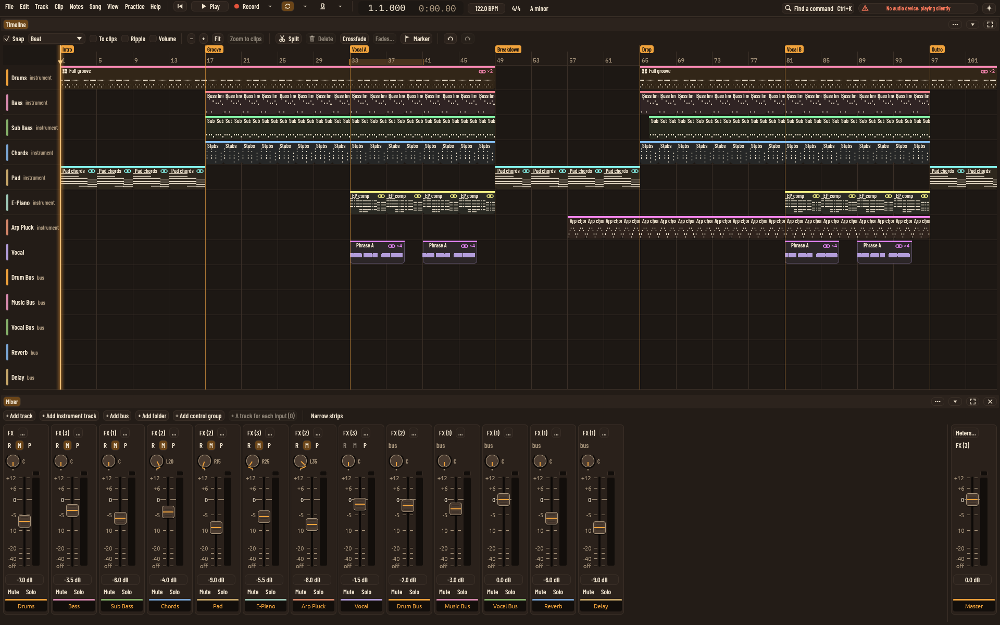

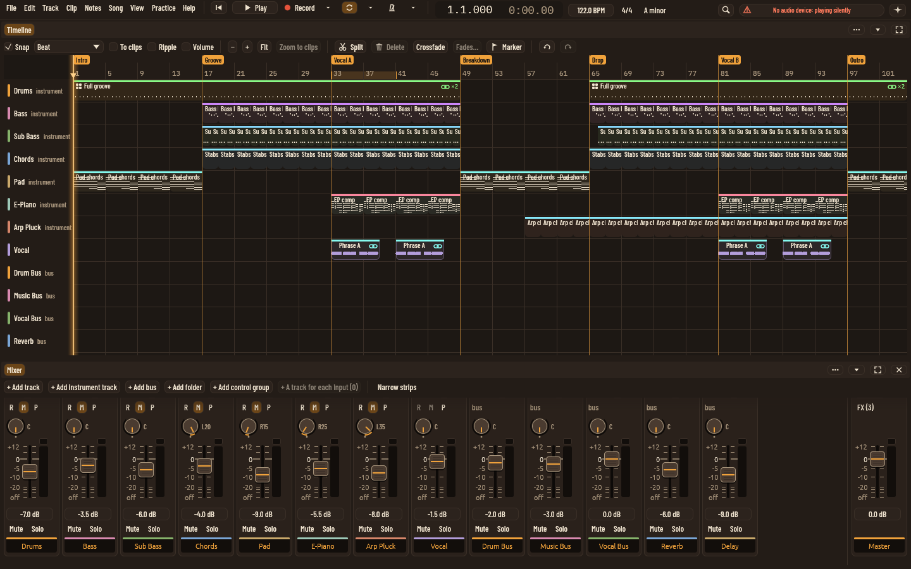

From the left:

- **The menus**, as in step one.
- **The transport**: back to the start, Play, Record, Loop and the
  metronome. Record, Loop and the metronome each have a small arrow
  that opens their options.
- **The position** in bars and in minutes and seconds (or timecode, if
  you chose to show it).
- **Tempo** (drag it, or double-click to type), then **time signature**
  and **key** as buttons that open small editors.
- On the right: **Find a command** (Ctrl+K), **one status pill**, and
  **AI assistants**.

### The option panels

| Was always on screen | Now |
|---|---|
| Punch bars, pre-roll and post-roll, always keep, Keep last, notes recording mode, Keep notes | Record options (arrow by Record) |
| Clicks per beat, click level, count-in | Metronome options (arrow by the metronome), plus the existing "higher click on the first beat" setting |
| Loop bars from and to | Loop options (arrow by Loop), or **drag the loop's ends along the foot of the ruler** |
| Time signature, Changes… | The time signature button: beats per bar, the beat, and "Tempo and signature changes…" |
| Key (only in the note editor before) | The key button: root, scale, or no key |
| Speed and presets, transpose and cents, tuning presets, detect tuning, the speed trainer | Practice → Speed and pitch… (opens under the tempo), until the Practice panel is built |
| Device, rate, DSP load, "No audio device", busy work, recording or disk problems | The status pill shows the most important line; click it for all of them, with Audio settings… and Performance… |

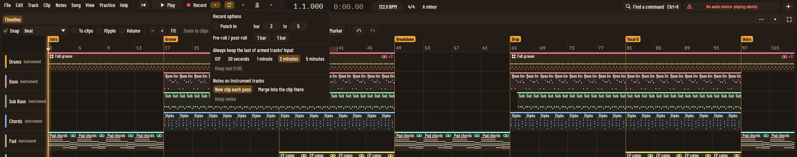
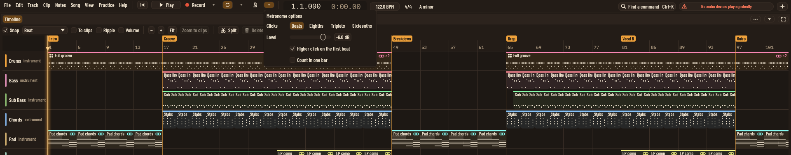
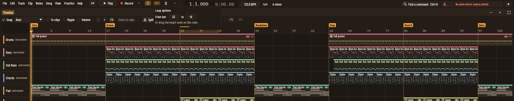
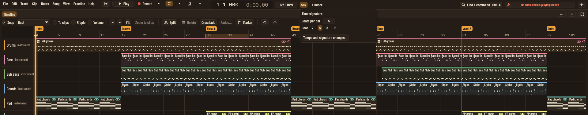
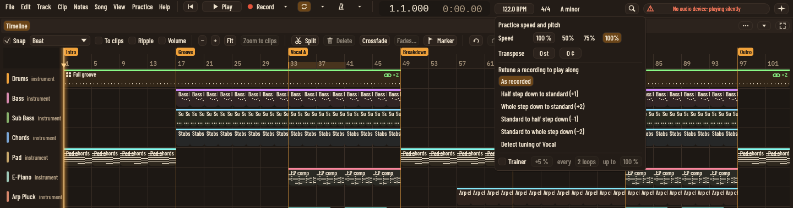
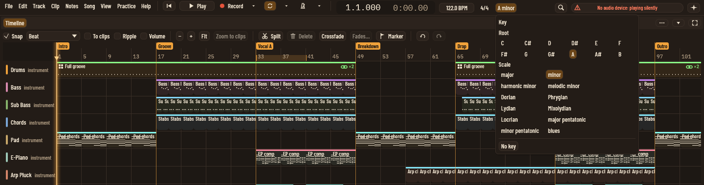
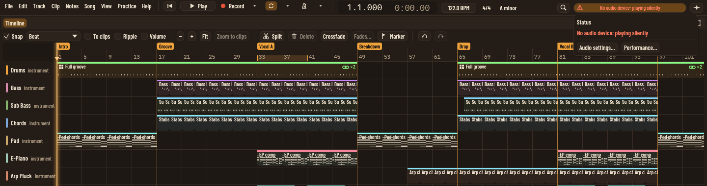

The panels use switches instead of drop-downs, as the plan's panel kit
suggests. Clicking elsewhere or pressing Escape closes them.

**Simpler mode**: bigger buttons, Loop and Click are labelled, and the
time signature and key are hidden.

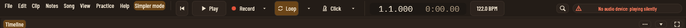
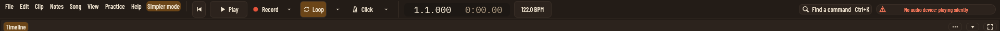

## For assistants

- New commands: `record-options`, `loop-options`, `metronome-options`
  and `speed-options` open a panel for the person to see. `keep-last`
  makes takes of what armed tracks played without Record on (before
  this, only a button did that).
- New tool `set_record_options`: punch in and out, pre-roll,
  post-roll, how much input is kept, and how notes are recorded.
  These controls had no assistant route before. `get_transport` now
  reads them back as `record_options`.
- `set_practice` can now set the metronome's `accent`.
- `get_selection` says which panel is open, as `top_bar`.
- End-to-end tests: `top_bar::tests` (driven through the assistant
  interface, plus dragging the loop's end on the ruler).
