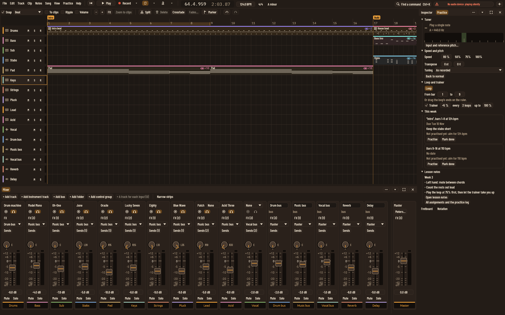
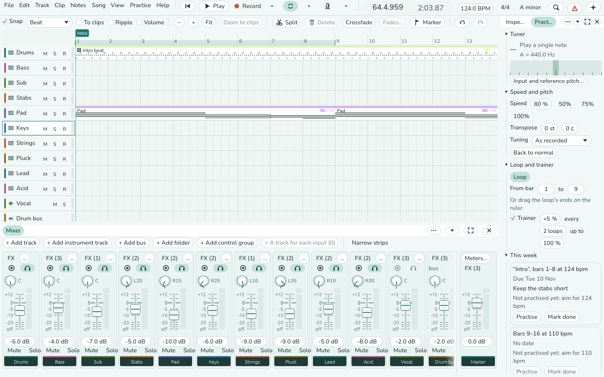
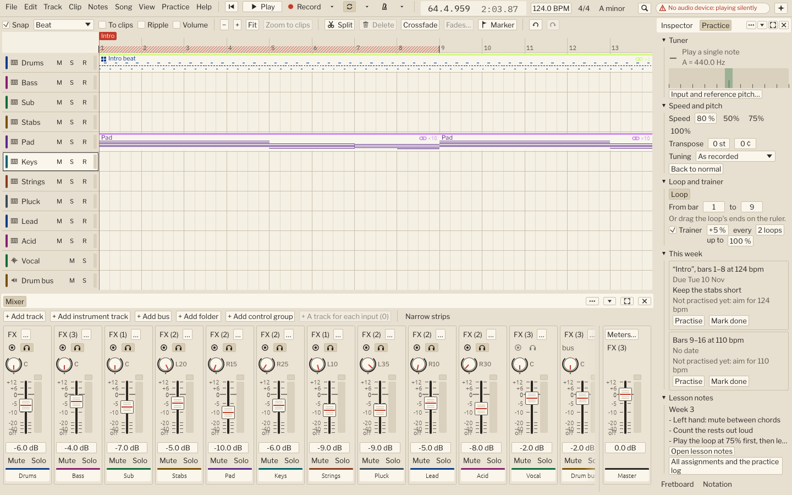
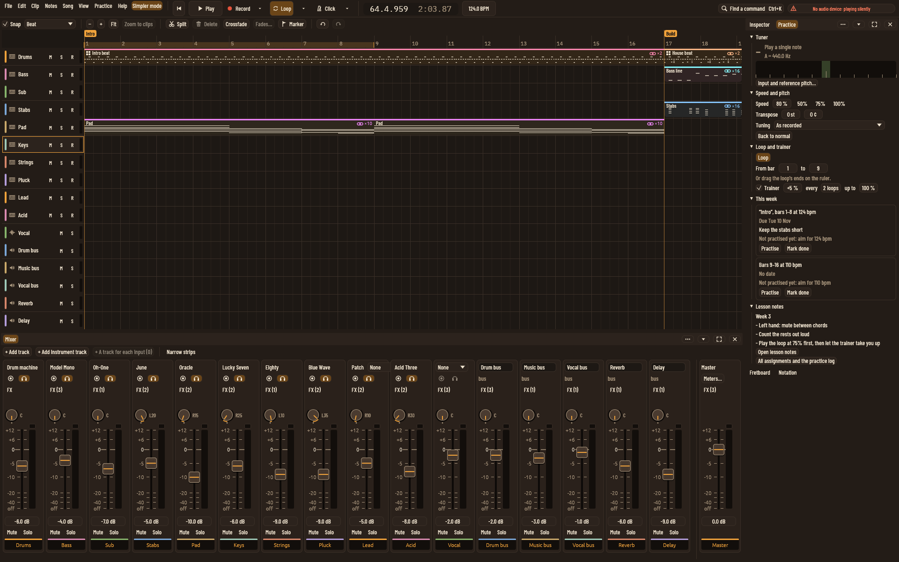

# UI polish, step eight: the Practice panel

Part of step eight of the UI polish plan (`docs/plans/ui-polish.md`,
section 8). The right panel has a Practice tab that gathers what a
lesson needs. Practice → Practice panel opens it (command
`practice-panel`); the Lesson layout (layout 3) now shows it first, in
place of the tuner; and turning the simpler mode on opens it.

## What is in it

From the top, each part under a heading that folds away:

- **Tuner**: the note heard, its cents and frequency, and the needle.
  It listens while the panel shows (or the tuner's own tab is open).
  "Input and reference pitch…" opens the tuner's own tab.
- **Speed and pitch**: speed with 50, 75 and 100%; transpose in
  semitones and cents; the tuning presets as a list; Back to normal.
- **Loop and trainer**: Loop on or off, the loop's bars, and the speed
  trainer.
- **This week**: the assignments this user hasn't done or reached the
  tempo of yet that are due within seven days, are late, or have no
  date; soonest first. Each has its bars, note, this user's progress,
  Practise and Mark done.
- **Lesson notes**: the first six lines, Open (or Write) lesson notes,
  and All assignments and the practice log (the Lessons tab).
- **Fretboard** and **Notation** buttons: the fretboard pane, and the
  notation lane for the track it would show.

Every control runs the same command or changes the same setting as its
own window, so nothing behaves differently.

## For the AI assistants

- `set_pane` takes `practice`; `get_selection` gives `practice_panel`:
  whether it is open, the tuner (listening, note, cents, Hz) and the
  ids of this week's assignments.
- The controls are `set_practice`, `set_loop`, `edit_assignments` and
  the commands, as before.
- End-to-end test: `practice_panel::tests::an_assistant_opens_the_practice_panel_and_reads_it`.

## Renders

## Choices made without the owner

- [ ] "This week" means due within seven days, late, or no date, and
      not yet done or reached by you.
- [ ] The tuner listens whenever the panel shows its tuner part; fold
      the part away to stop it.
- [ ] Simpler mode opens the panel when turned on; closing it then
      keeps it closed.
- [ ] The Lesson layout shows Practice, Lesson notes and Comments; the
      tuner's own tab is no longer in it.
