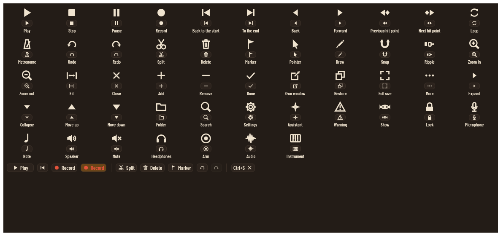
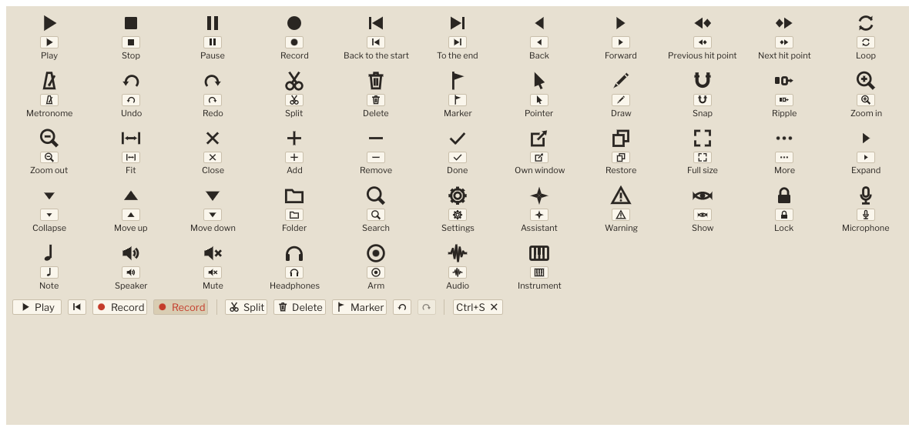
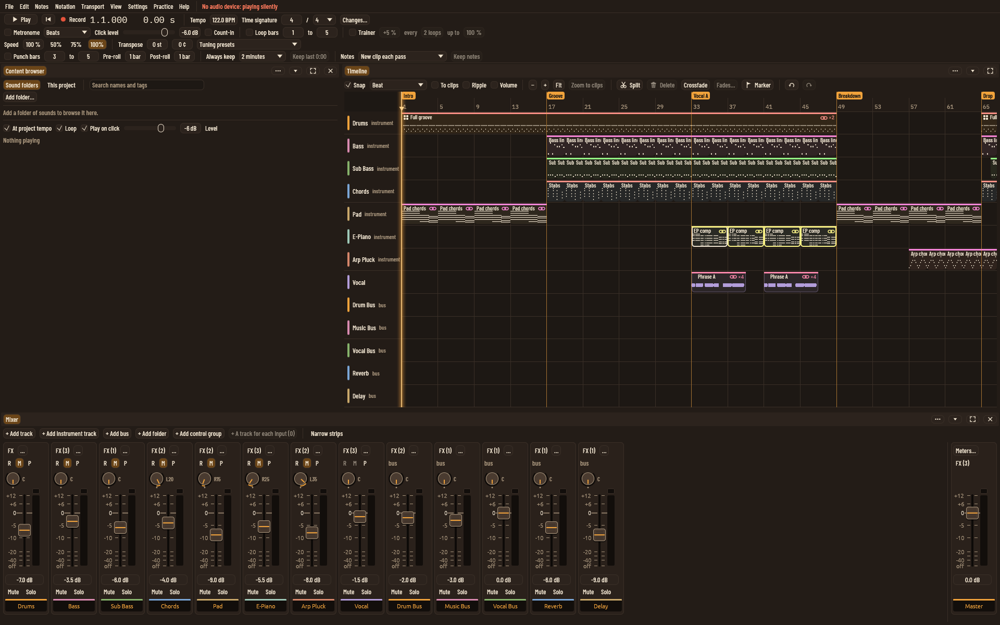
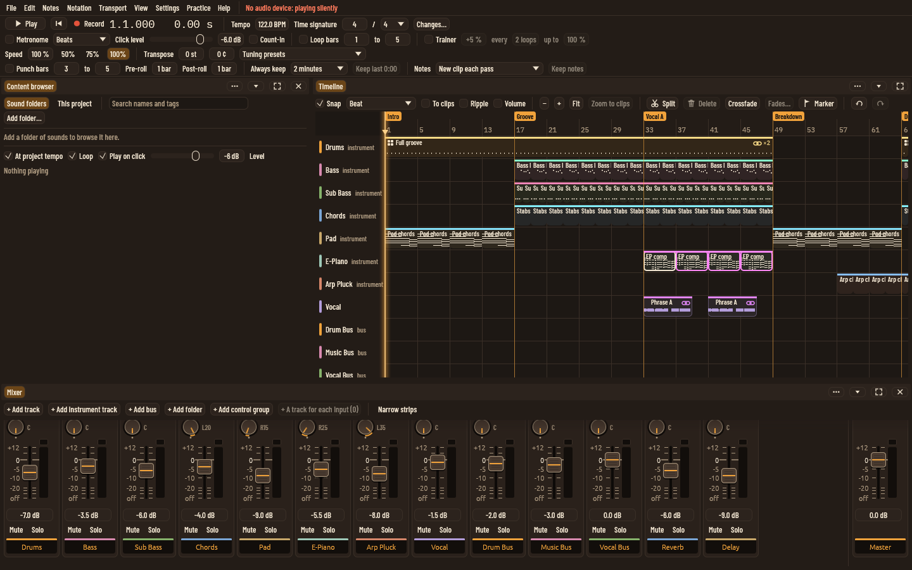
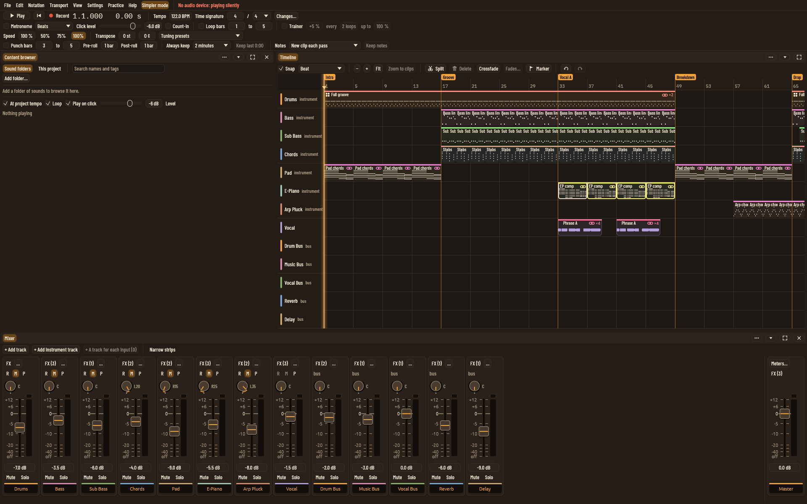
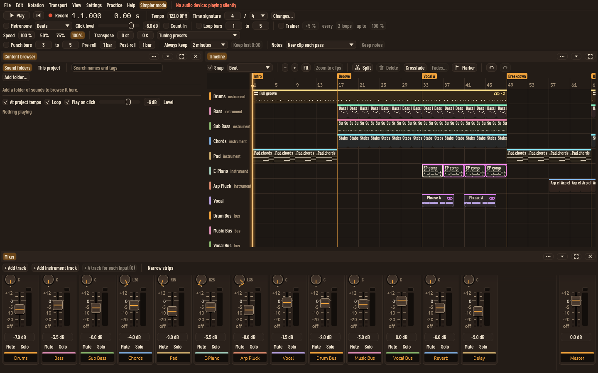

# UI polish, step 1: drawn icons

Step one of the UI polish plan (`docs/plans/ui-polish.md`, section 3).
The app's icons were Unicode symbols, which need a font that has them;
since the move to egui 0.37 most showed as empty boxes. A first small
change turned egui's symbol fonts back on as a stopgap. This one draws
the icons in our own code, so they look the same on every computer.

What changed:

- **`crates/app/src/icons.rs`**: 51 icons drawn as vector shapes (lines,
  circles, filled shapes) in a unit square, scaled to the text size, in
  the button's text colour or a theme token (the record dot uses the
  theme's `record` colour). Transport (play, stop, pause, record, back
  to the start, to the end, frame back and forward, previous and next
  hit point, loop, metronome), editing (undo, redo, split, delete,
  marker, pointer, draw, snap, ripple, zoom in and out, fit), panels
  (close, add, remove, done, own window, restore, full size, more,
  expand, collapse, move up and down, folder, search, settings,
  assistant, warning, show, lock) and tracks (microphone, note,
  speaker, mute, headphones, arm, audio, instrument). About half are
  used now; the rest are ready for the top bar, the edit toolbar and
  the track headers in the next steps.
- **`IconButton`**: an egui button with a drawn icon, with or without
  text. An icon-only button always has a tooltip and an accessible name
  ("Remove send to Reverb"), so screen readers and the assistant
  interface can find it. A button with text is named by its text, or by
  a longer spoken name where the word alone is unclear (the toolbar's
  Delete is "Delete the selected clips").
- Every symbol icon in the app is replaced: the transport, the timeline
  toolbar (split, delete, marker, undo, redo), pane headers (close, own
  window, full size, collapse, more), effect and layer lists (move up,
  move down, remove), note effects, mixer sends, automation lanes,
  hit points, the video pane, the content browser, presets, key
  commands, export results and talkback. A test fails if a symbol
  icon comes back into the source.
- A clip's tempo in its name now reads "· 120 BPM" rather than a
  crotchet symbol.

Checks:

- `icons::tests::every_icon_draws_inside_its_square`, and
  `no_symbol_icons_are_left_in_the_source`.
- `icons::in_the_app::the_icon_buttons_do_what_they_say_and_the_assistant_sees_it`:
  an assistant imports a clip; the drawn Split, Undo, Delete and Marker
  buttons are pressed by their spoken names and the assistant sees each
  change through `get_project`; in simpler mode Play, Back to the start
  and Record are still there by name, and Record works.
- The `// ai:` coverage check counts icon buttons with text as controls
  too; the existing accessibility tests pass unchanged apart from the
  record button's name, now "Record".

Renders (the README screenshot recipe, its patch now
`/mnt/project-files/screenshots/readme/readme-shots-with-icons.patch`
with the tests `icon_sheet` and `icon_review`):

The icon sheet in all four themes, light and dark, is in the project
files under `ui-polish/icons/`.

For the owner to look at:

1. Do the icons read clearly at their size, in each theme? Any to
   redraw (the eye and the ripple are the least obvious)?
2. The record dot is always the record colour, even when not recording,
   so it is easy to find. Keep that, or grey until armed?
3. Not icons, but still boxes: the pitch editor names notes with the
   sharp sign (C♯), which none of the bundled fonts has. Write them
   as C# instead, or bundle a font that has it?
